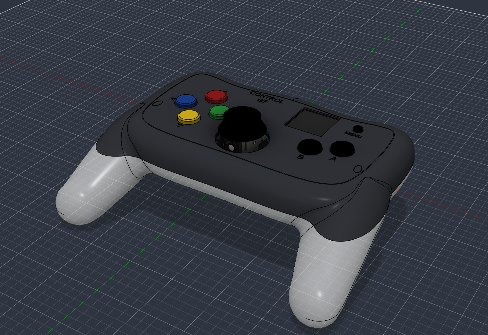

# Control G7 — gamepad USB con pantalla para juegos de PC

**IND474 Desarrollo de Productos Físicos · Universidad Adolfo Ibáñez · Grupo 7**
Fernando Guaita · Guillermo Hidalgo · Vicente Kohler · Eduardo Rojas



Control G7 es un gamepad USB que el PC reconoce sin drivers. Tiene cruceta, A, B, MENU, un joystick analógico y una pantalla de 1,3" que muestra el modo y las confirmaciones. Funciona como **gamepad HID** (juegos de PC en general) o como **teclado** (juegos que solo aceptan teclado).

## Estado (23/11/2026)

| Parte | Estado |
|---|---|
| PCB D4.4 fabricada y soldada | ✅ |
| Firmware v1.2 (gamepad + teclado, pantalla, recalibración) | ✅ probado en gamepad-tester, SuperTux y el dinosaurio de Chrome |
| Carcasa v6 (Fusion 360) | ✅ diseñada · ⏳ sin imprimir |
| Bring-up medido (3V3, 5V, consumo) | ⏳ pendiente — ver [hardware/bring-up](hardware/bring-up/README.md) |
| Probeta de holguras y muestras CMF | ⏳ pendiente |
| Prueba con 5 usuarios | ⏳ pendiente — ver [experiencia](experiencia/README.md) |

Lo pendiente se marca así a propósito: no publicamos resultados que todavía no medimos.

## Cómo usarlo

1. Enchufar por USB-C **con el stick suelto** (se calibra el centro al conectar).
2. Windows lo muestra como **"Control G7"**.
3. Atajos:
   - **MENU + B (1,5 s):** cambia entre GAMEPAD y TECLADO (queda guardado).
   - **MENU + A (1,5 s):** recalibra el centro del stick.

| Control | Modo GAMEPAD | Modo TECLADO |
|---|---|---|
| Stick | Ejes X / Y | Flechas |
| Cruceta | Hat (con diagonales) | Flechas |
| A / B | Botón 1 / 2 | Z / X |
| MENU | Botón 8 (Start) | Enter |
| Clic del stick | Botón 9 (L3) | Espacio |

## Estructura del repositorio

| Carpeta | Contenido |
|---|---|
| [`hardware/`](hardware) | KiCad, Gerber, BOM, planos, DRC/ERC, cambios desde la D4.4 y bring-up |
| [`firmware/`](firmware) | Firmware `G7_Gamepad` v1.2 y las 4 pruebas por partes con sus lecturas |
| [`cad/`](cad) | Fusion 360 (`.f3d`), STEP del ensamble, STL para imprimir, renders, scripts y modelos de componentes |
| [`experiencia/`](experiencia) | Perfil de usuario, protocolo de la prueba con 5 personas, planilla y resultados |
| [`docs/`](docs) | Presentación (PDF), resumen de la carcasa y diagramas |
| [`DECISIONES.md`](DECISIONES.md) | Decisiones de diseño y por qué cambiaron desde la propuesta |

## Arquitectura

```
Cruceta, A, B, MENU ──┐
Joystick KY-023 ──────┼──► Waveshare RP2350-Plus ──► USB-C ──► PC (gamepad HID o teclado)
                      │     núcleo 0: entradas + USB a 1 kHz
                      │     núcleo 1: pantalla ST7789
```

- **Microcontrolador:** Waveshare RP2350-Plus, soldado por la cara trasera de la PCB.
- **Firmware:** Arduino-Pico 6.3.2 (Arduino IDE 2.3.11) + librerías Adafruit ST7789 y GFX.
- **Carcasa:** concha impresa en PLA/PETG (Bambu A1), pared de 2,4 mm; la PCB se atornilla a la tapa con 4 × M2 y la base cierra con 6 clips.

## Referencias

- [Alpakka — Input Labs](https://inputlabs.io/alpakka): referente de mando abierto (integración física y documentación).
- [Arduino-Pico](https://github.com/earlephilhower/arduino-pico): núcleo sobre el que corre el firmware.
- [Adafruit ST7735/ST7789](https://github.com/adafruit/Adafruit-ST7735-Library) y [Adafruit GFX](https://github.com/adafruit/Adafruit-GFX-Library).
- [Waveshare RP2350-Plus](https://www.waveshare.com/wiki/RP2350-Plus).
- Norman, Rams, Ulrich y Thompson (material del curso) para ergonomía, forma y CMF.
